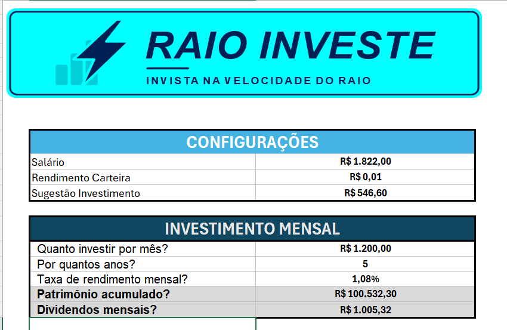
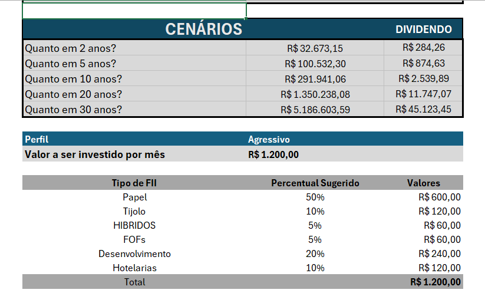
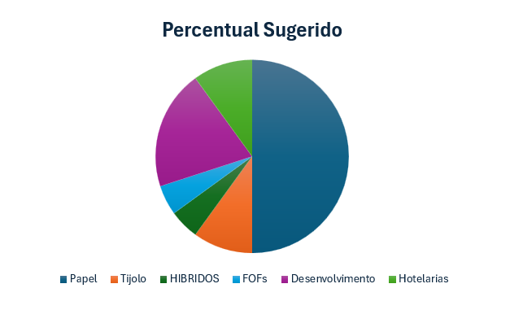

# Planilha de Investimentos em FIIs

Planilha em Excel que simula o crescimento do patrimônio com aportes mensais e sugere como dividir cada aporte entre os tipos de Fundos de Investimento Imobiliário (FIIs), de acordo com o perfil do investidor.

> **Aviso:** projeto educacional, feito para praticar Excel. Os valores e percentuais são exemplos e **não constituem recomendação de investimento**.

## Perguntas de negócio

O projeto foi construído para responder a estas perguntas:

- Quanto devo investir por mês, com base no meu salário?
- Quanto terei de patrimônio depois de X anos investindo todo mês?
- Quanto esse patrimônio pode gerar de dividendos por mês?
- Como o patrimônio muda em cenários de 2, 5, 10, 20 e 30 anos?
- Como dividir o aporte mensal entre os tipos de FII conforme o meu perfil (conservador, moderado ou agressivo)?

## O que a planilha faz

- **Configurações:** salário, rendimento da carteira e uma sugestão de aporte (30% do salário).
- **Simulador de patrimônio:** calcula o patrimônio acumulado a partir do aporte mensal, do número de anos e da taxa de rendimento mensal, além dos dividendos mensais estimados.
- **Simulador de cenários:** mostra o patrimônio e o dividendo estimado em 2, 5, 10, 20 e 30 anos.
- **Distribuição por perfil:** o usuário escolhe o perfil em uma lista suspensa e a planilha divide o aporte entre os seis tipos de FII: Papel, Tijolo, Híbridos, FOFs, Desenvolvimento e Hotelarias.
- **Gráfico de pizza** com a distribuição sugerida.

## Como usar

1. Baixe o arquivo `planilha_investimentos.xlsx` (na aba **Releases** ou na pasta `planilha/`).
2. Abra no Excel.
3. Na seção **Configurações**, informe seu salário e o rendimento da carteira.
4. Em **Investimento mensal**, defina quanto quer investir por mês, por quantos anos e a taxa de rendimento mensal.
5. Em **Perfil**, escolha Conservador, Moderado ou Agressivo e veja a divisão do aporte e o gráfico.

Exemplo com os valores padrão: aporte de R$ 1.200 por mês, durante 5 anos, a uma taxa de 1,079% ao mês (cerca de 13,7% ao ano) resulta em um patrimônio de aproximadamente R$ 100,5 mil.

## Estrutura

| Aba | Conteúdo |
| --- | --- |
| Simulador | Configurações, simulação de patrimônio, cenários, distribuição por perfil e gráfico |
| Base | Tabela com o percentual de cada tipo de FII por perfil |

## Técnicas e funções usadas

- **`VALORFUTURO` / `FV`:** cálculo do patrimônio acumulado com aportes mensais.
- **`PROCV` / `VLOOKUP`:** busca do percentual de cada tipo de FII, usando a chave `Perfil-Tipo` (por exemplo, `Moderado-TIJOLO`).
- **Nomes de intervalos:** `salario`, `aporte`, `qtd_anos`, `taxa_mensal`, `rendimento_carteira`, `patrimonio_acumulado` e `sugest_invest`, que deixam as fórmulas mais legíveis.
- **Variáveis globais:** os parâmetros ficam em células únicas, usadas por todas as fórmulas.
- **Validação de dados:** lista suspensa para escolher o perfil.
- **Gráfico de pizza** ligado à distribuição sugerida.
- **Uniformidade visual:** padronização de cores, tipos de fundo e formatação.

## Premissas e limitações

- A taxa de rendimento é fixa e constante ao longo do tempo. Na prática, ela varia.
- Os dividendos mensais são estimados como um percentual fixo sobre o patrimônio.
- Os percentuais por perfil são ilustrativos e não vêm de nenhuma recomendação oficial.
- Não considera inflação, impostos, taxas nem variação do valor das cotas.

## O que aprendi

- Transformar perguntas de negócio em uma estrutura de planilha.
- Organizar a base de dados e os pré-requisitos antes de montar as fórmulas.
- Criar um simulador de patrimônio e um simulador de cenários.
- Usar variáveis globais e nomear intervalos.
- Criar uniformidade visual e usar tipos de fundo para melhorar a leitura.

## Licença

Distribuído sob a licença MIT. Veja o arquivo `LICENSE`.

## Autor

**Isabella Raio**
LinkedIn: [linkedin.com/in/isabella-raio-02b08635a](https://www.linkedin.com/in/isabella-raio-02b08635a)
